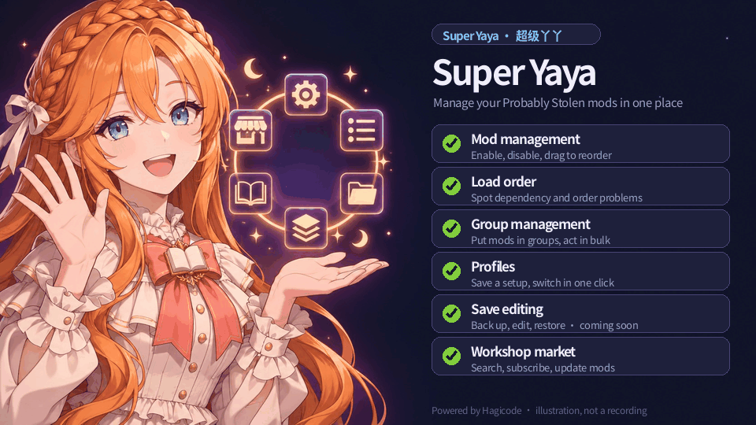
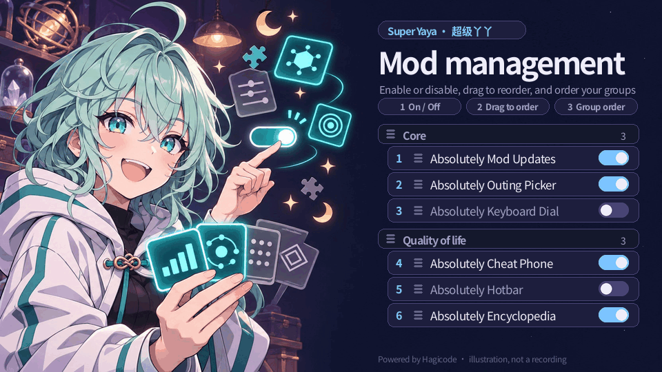
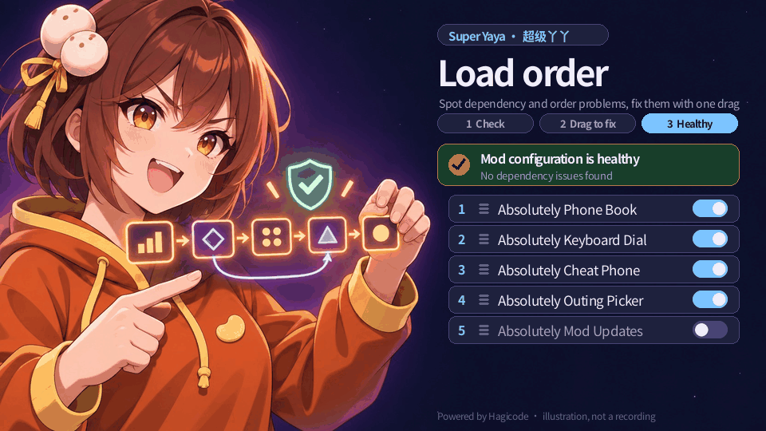
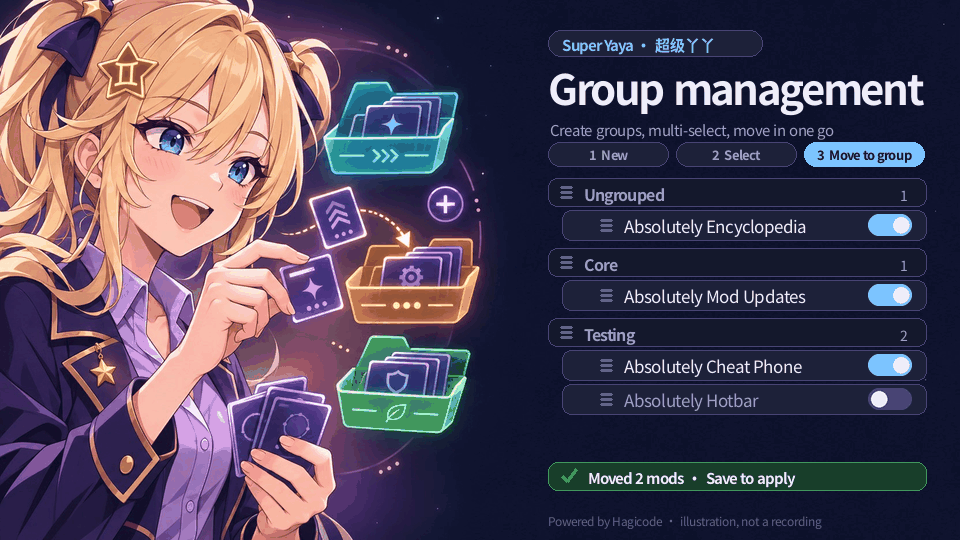
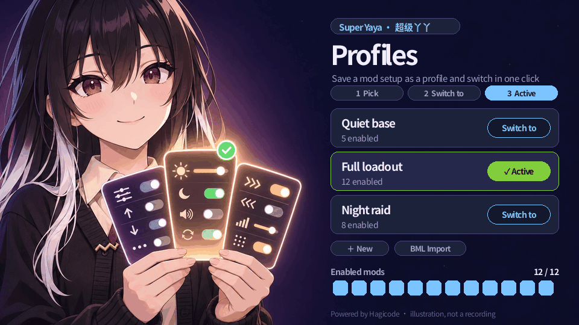
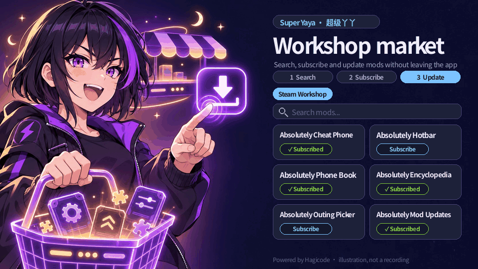
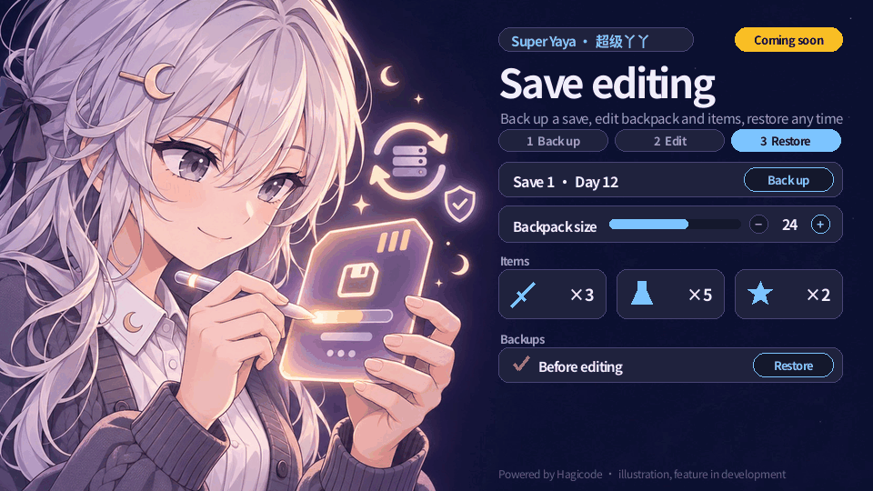

# SuperDucky Docs

[简体中文](./README_cn.md)

SuperDucky Docs is the documentation site for SuperDucky. It brings product introductions, installation instructions, guides, and release notes together so you can find the next step for your task.

**[Read the documentation →](https://sd.hagicode.com/en-US/)**

## What you'll find

- [Product overview](https://sd.hagicode.com/en-US/product-overview/) — Start here to learn what SuperDucky is.
- [Release notes](https://sd.hagicode.com/en-US/release-notes/) — Read about changes between versions.
- [Blog](https://sd.hagicode.com/en-US/blog/) — Explore articles and tutorials.

## About SuperDucky

SuperDucky (超级丫丫) is a cross-platform desktop mod manager for PC games. It supports Escape from Duckov, Probably Stolen (深空当铺) and The Binding of Isaac (以撒的结合), and handles mods, load order where a game has one, groups, suites and the Steam Workshop market.

*The pictures below are animated illustrations drawn from the app's menus, not screen recordings.*

- [Official site](https://sd.hagicode.com/en-US/)
- [Download from the Microsoft Store](https://apps.microsoft.com/detail/9ndbtdkqbx30)
- [Releases (latest and earlier versions)](https://github.com/HagiCode-org/SuperDucky.Release/releases)
- [Super Yaya guide mod on Steam Workshop](https://steamcommunity.com/sharedfiles/filedetails/?id=3844875899) — an optional in-game signpost to SuperDucky; you do not need it.

### Mod management

Enable, disable and reorder mods in one list, with drag-to-order and group ordering.

### Load order

Spot dependency and order problems before you start the game.

### Groups

Collect mods into groups and order the groups.

### Suites

Save each mod setup as a suite and switch between them.

### Market

Browse Steam Workshop mods without leaving the app.

### Save editing (coming soon)

Edit your save files from the same place. This feature is not released yet.

More topics will appear here as the documentation grows. Use the documentation site's language selector to choose your preferred reading language.
